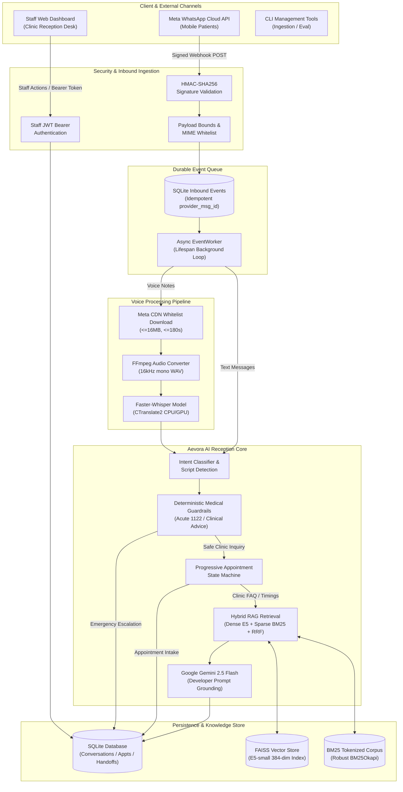

# Aevora AI — System Architecture & Technical Specifications

> **Healthcare conversations, made human.**  
> Virtual Multilingual Clinic Receptionist for NovaCare Medical Centre (Fictional Demo Dataset).

---

## 1. Architectural Overview

Aevora AI is built as a **modular monolith** in Python 3.12 and FastAPI. It couples hybrid document retrieval, deterministic clinical safety guardrails, conversational state machines, and real-time messaging transport adapters (WhatsApp Cloud API and web) into a cohesive, zero-cost, locally deployable backend.



---

## 2. Core Subsystems

### 2.1 Hybrid RAG Engine (`app/rag/`)
- **Dense Vector Search**: `sentence-transformers` running `intfloat/multilingual-e5-small` generating 384-dimensional L2-normalized embeddings. Indexed via `faiss.IndexFlatIP` for mathematically exact cosine similarity.
- **Sparse Keyword Search**: `RobustBM25Okapi` with Unicode-aware tokenization, non-negative floor IDF protection, and Roman Urdu alias normalization.
- **Reciprocal Rank Fusion (RRF)**: Combines dense and sparse rank scores ($k=60$) with an evidence sufficiency threshold: queries lacking keyword matches with vector score $< 0.84$ or RRF score $< 0.015$ trigger `insufficient_evidence=True`.

### 2.2 Receptionist Orchestration & LLM Client (`app/ai/`)
- **SDK**: Official `google.genai` SDK using `http_options={'api_version': 'v1beta'}` to support developer system instructions.
- **Thinking Budget Control**: Configured with `types.ThinkingConfig(thinking_budget=0)` to prevent reasoning tokens from consuming output quota and eliminating truncation.
- **Persona & Prompting**: Mobile-optimized, warm, concise, professional virtual assistant strictly bound to retrieved evidence with zero clinical diagnosis or prescription claims.
- **Model Fallback**: `gemini-2.5-flash` primary with fallback to `gemini-1.5-flash` and deterministic `MockLLMClient` for offline test suites.

### 2.3 Deterministic Medical Safety Guardrails (`app/ai/safety.py`)
- Evaluated prior to any LLM invocation.
- **Acute Emergency Deflection**: Keywords across English, Urdu script, and Roman Urdu (chest pain, stroke, unconsciousness, severe bleeding, poison, choking) trigger immediate guidance to call **1122** (Emergency Rescue) and simultaneously open an urgent human staff handoff.
- **Clinical Advice Deflection**: Requests for medication dosages, antibiotics, prescriptions, or symptom diagnosis are politely deflected with an offer to schedule an in-person doctor consultation.

### 2.4 Progressive Appointment Intake State Machine (`app/services/appointment_service.py`)
- Enforces turn-by-turn collection of 5 mandatory intake fields:
  1. Patient full name
  2. Doctor or clinical specialty
  3. Preferred date
  4. Preferred time
  5. Callback contact phone number
- Summarizes all collected slots and requires explicit user confirmation (`Yes`, `Haan`) before recording.
- Sets status strictly to `pending_staff_confirmation` (never falsely claiming an appointment is booked into a live clinical EHR without human staff review).

### 2.5 Meta WhatsApp Cloud API Adapter (`app/whatsapp/`)
- Supports Meta Graph API `v22.0`.
- Cryptographic GET verification (`hub.mode`, `hub.verify_token`, `hub.challenge`).
- Cryptographic POST validation verifying `X-Hub-Signature-256` HMAC-SHA256 digests in constant time.
- Durable SQLite `InboundEvent` queue with unique constraint on `provider_message_id`, eliminating duplicate responses on Meta network retries.
- Asynchronous background `EventWorker` polling and processing events with bounded exponential backoff.

### 2.6 Voice Note Processing Pipeline (`app/voice/`)
- Authenticated download from whitelisted Meta CDN domains (`lookaside.fbsbx.com`, `*.facebook.com`, `*.fbcdn.net`).
- File bounds enforcement: $\le 16\text{MB}$ and $\le 180\text{s}$ duration.
- Conversion to 16kHz mono WAV via FFmpeg (with automatic fallback to bundled `imageio-ffmpeg` binary).
- Transcription using Faster-Whisper (auto-probing CUDA GPU with graceful fallback to CPU `int8`).
- Guaranteed temporary file cleanup in `temp_audio/` within `finally` blocks.

### 2.7 Staff Management Dashboard (`app/static/dashboard/` & `app/api/routes/staff.py`)
- Responsive single-page application built on strict healthcare design tokens:
  - Deep navy: `#142B3A`
  - Primary teal: `#126E75`
  - Warm off-white: `#F7F6F2`
  - Pale mint: `#EAF3F1`
  - Restrained coral: `#C96F5D`
  - Muted gold: `#B89455`
- JWT Bearer token authentication with PBKDF2 password hashing.
- Modules:
  - Operational Overview & Live Reception Metrics
  - Conversation Thread Viewer (supporting English, Urdu script, and Roman Urdu)
  - Appointment Intake Management (confirm or cancel)
  - Staff Triage & Escalation Handoffs
  - Knowledge Base Status & Source Tracking
  - Real-Time Integration Diagnostics

---

## 3. Storage Architecture

```
aevora-ai/
├── aevora.db                # SQLite database (conversations, messages, appointments, handoffs, events, staff)
├── data/
│   ├── documents/           # Canonical source documents (JSON & PDF)
│   └── vector_store/        # FAISS index (faiss_index.bin), BM25 corpus, manifest
└── temp_audio/              # Transient audio processing directory (auto-cleaned)
```

---

## 4. Hardware & Runtime Constraints

- **Python Runtime**: Python 3.11 or 3.12 (64-bit).
- **Target OS**: Windows 10/11 (fully portable to Linux/macOS).
- **Zero Paid Infrastructure**: Runs on standard local machine without AWS, Azure, Pinecone, or Redis.
- **CPU Default**: Fully operational on 4-core standard CPU. If an NVIDIA CUDA GPU is available, CTranslate2 automatically accelerates Faster-Whisper.
